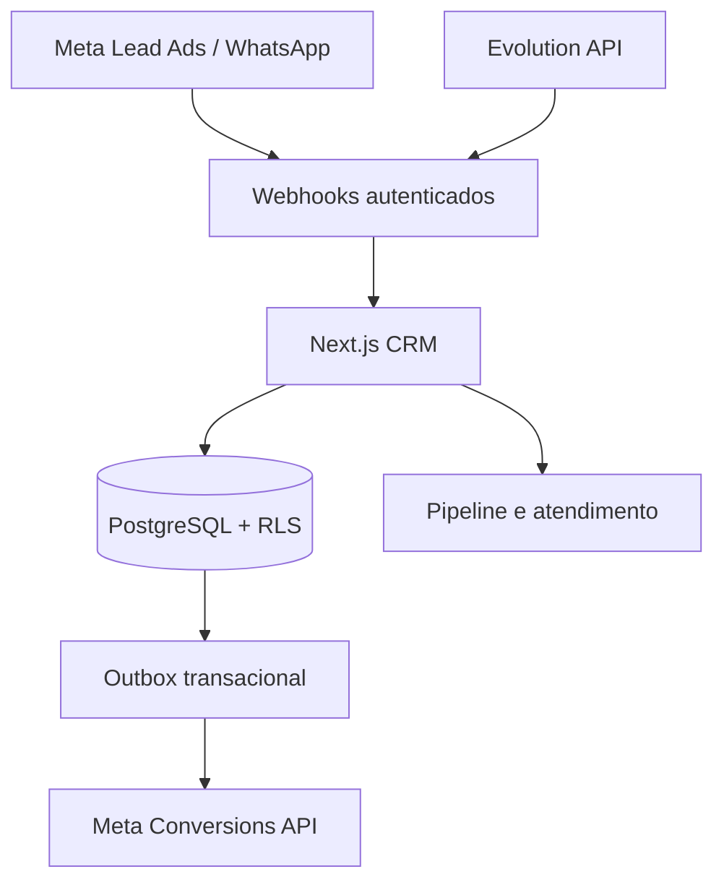

# Atlas Growth CRM — Estudo de caso

CRM multitenant desenvolvido para centralizar leads, conversas, funil comercial e mensuração de resultados de campanhas.

## Principais recursos

- Pipeline visual com etapas personalizáveis.
- Contatos, leads, tarefas, notas e linha do tempo.
- Recebimento de leads por webhooks da Meta.
- Integração com WhatsApp via Evolution API e Cloud API.
- Convites de equipe e permissões por empresa.
- Envio de eventos de conversão para a Meta por fila confiável.
- Auditoria e isolamento multitenant.

## Arquitetura

## Decisões técnicas relevantes

- Idempotência para impedir leads e mensagens duplicados.
- Tokens criptografados e operações externas somente no servidor.
- Outbox transacional com retry e dead-letter para eventos de conversão.
- Webhooks validados antes de persistir dados.
- Implantação isolada em Docker, compartilhando infraestrutura sem interromper outros serviços.

## Stack

Next.js, React, TypeScript, Supabase, PostgreSQL, Meta APIs, Evolution API, Docker, Nginx/Caddy e testes automatizados.

## Minha participação

Desenvolvimento full stack, modelagem do banco, integrações, segurança multitenant, automações, deploy e diagnóstico de produção.

> Estudo de caso sanitizado: sem dados pessoais, tokens, endereços internos ou código comercial sensível.
